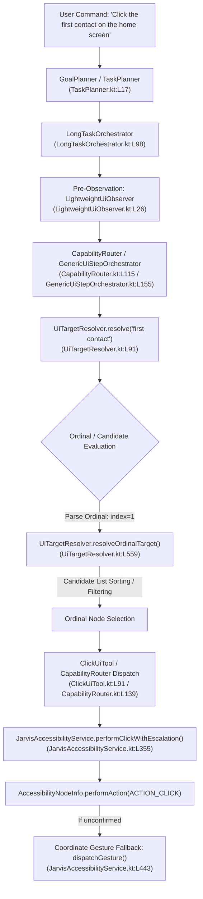

# MAX Home First Contact Card Click Audit

## 1. Problem Reproduction

### Scenario Description
- **Command / Goal**: "Click the first contact on the home screen." / "Click first contact" / "Tap first contact card"
- **Environment**: Redmi K20 Pro / Android 16 physical test device (Package: `com.example.voice`, Activity: `MainActivity`).
- **Target UI State**: MAX App Home Screen loaded in empty state / dashboard mode (`FlagshipDashboardEmptyState` in `HomeScreen.kt`).
- **Visible Elements on Screen**:
  1. Top Bar: Menu Button, AI Avatar ("M"), Title "MAX AI", Live status, MoreVert Options.
  2. Hero Greeting Card: "Hello, I am MAX", Subtitle.
  3. Quick Actions Header: "Quick Actions & Shortcuts".
  4. Quick Actions 2x2 Grid:
     - Card 1: **"Send WhatsApp"** (Subtitle: "Message Mom or friends", Icon: ChatBubbleOutline)
     - Card 2: **"Set Alarm"** (Subtitle: "Wake up or timers", Icon: Alarm)
     - Card 3: **"Screen Vision"** (Subtitle: "Read what's on screen", Icon: Visibility)
     - Card 4: **"Reminders"** (Subtitle: "Check your schedule", Icon: Schedule)
  5. Suggested Commands Header: "Suggested Commands".
  6. Suggested Command Items:
     - Item 1: **"Send a WhatsApp message to Mom"**
     - Item 2: **"Set an alarm for 7 AM"**
     - Item 3: **"Read what's on my screen"**
     - Item 4: **"Check today's reminders"**
     - Item 5: **"What is on my calendar today?"**
  7. Composer Pill: Plus button, Mic button, Send button.

### Failure Symptoms
When the command *"Click the first contact on the home screen"* is triggered:
1. No click event is dispatched or an incorrect node is clicked.
2. The UI does not transition to a chat/contact screen.
3. The resolver logs: `Target 'first contact' could not be resolved with confidence >= 0.85 (Best score: 0.0)` or ordinal resolution falls back to an unrelated top container child.

### Runtime State Capture
- **Active Package**: `com.example.voice`
- **Active Window**: `MainActivity` (Window ID: system main activity window)
- **Target Query**: `"first contact"`
- **Target Content Description**: `null`
- **Target Resource ID**: `null` (Jetpack Compose elements do not assign View resource IDs by default)
- **Target ClassName**: `android.view.View` / Compose Subtree
- **Clickable Nodes on Screen**: `Surface` container of Card 1 (`clickable = true`), `IconButton` (`clickable = true`), `Text` children (`clickable = false`).
- **Enabled**: `true`
- **VisibleToUser**: `true`
- **Focusable**: `false`
- **AccessibilityFocused**: `false`

---

## 2. Runtime Click Path

Tracing the end-to-end execution path from utterance to accessibility click:



### Stage-by-Stage Line Mapping:
1. **User Command Dispatch**:
   - `ActionDispatcher.kt:L109-125` & `L237-255` → dispatches `TaskIntent` or `ExecutionRequest` to `LongTaskOrchestrator`.
2. **Task Planning**:
   - `TaskPlanner.kt:L17-37` (`createPlan()`) & `L211-223` (`routeTier3LongHorizon()`) creates `TaskStep(action = UiStep.Tap(target = "first contact"))`.
3. **Orchestration**:
   - `LongTaskOrchestrator.kt:L98-179` (`executeTask()`) processes the `UiStep.Tap` step and delegates to `CapabilityRouter.kt:L115-147`.
4. **Pre-Observation**:
   - `LightweightUiObserver.kt:L26-72` captures fresh screen state and signature via `AccessibilityTreePruner.kt:L96-111`.
5. **Target Resolution**:
   - `UiTargetResolver.kt:L91-305` (`resolve()`) receives query `"first contact"`.
   - `UiTargetResolver.kt:L183-199` parses ordinal `index = 1` via `parseOrdinal("first contact")`.
   - `UiTargetResolver.kt:L559-647` (`resolveOrdinalTarget()`) filters and selects candidates.
6. **Execution Engine & Action Authorization**:
   - `ExecutionEngine.kt:L17-105` validates `ExecutionRequest` and executes tool (`ClickUiTool.kt:L42-179`).
7. **Accessibility Dispatch**:
   - `JarvisAccessibilityService.kt:L355-416` executes `performClickWithEscalation()`.
   - `JarvisAccessibilityService.kt:L377-384` tries `current.performAction(AccessibilityNodeInfo.ACTION_CLICK)`.
   - `JarvisAccessibilityService.kt:L418-470` executes gesture fallback `dispatchGesture()` if ACTION_CLICK is unconfirmed.

---

## 3. Accessibility Tree Findings

### Runtime Tree Structure of MAX Home Screen (Compose):
The MAX Home Screen UI (`HomeScreen.kt`) is built with Jetpack Compose `LazyColumn` containing:
```text
Root: android.view.View [bounds=[0,0][1080,2400], clickable=false]
 └── android.view.View (LazyColumn) [bounds=[0,180][1080,2220], scrollable=true]
      ├── Node 0: Top Bar Header [clickable=false]
      │    ├── Button: Menu [clickable=true, desc="Open Drawer", bounds=[36,198][156,318]]
      │    ├── Text: "MAX AI" [clickable=false, bounds=[282,216][450,268]]
      │    └── Button: Options [clickable=true, desc="Options", bounds=[924,198][1044,318]]
      ├── Node 1: Hero Greeting Card Surface [clickable=false, bounds=[48,348][1032,820]]
      │    ├── Icon: AutoAwesome [clickable=false]
      │    ├── Text: "Hello, I am MAX" [clickable=false, bounds=[320,540][760,600]]
      │    └── Text: "Your intelligent assistant..." [clickable=false]
      ├── Node 2: Section Header [clickable=false, bounds=[60,832][1020,875]]
      │    └── Text: "Quick Actions & Shortcuts" [clickable=false]
      ├── Node 3: Row 1 (Quick Action Cards 1 & 2) [clickable=false, bounds=[48,885][1032,1260]]
      │    ├── Card 1 Surface [clickable=true, bounds=[48,885][528,1260]]  <-- TARGET: FIRST CARD ("Send WhatsApp")
      │    │    ├── Icon: ChatBubbleOutline [clickable=false]
      │    │    ├── Text: "Send WhatsApp" [clickable=false, bounds=[96,1080][480,1130]]
      │    │    └── Text: "Message Mom or friends" [clickable=false, bounds=[96,1140][480,1180]]
      │    └── Card 2 Surface [clickable=true, bounds=[552,885][1032,1260]] <-- CARD 2 ("Set Alarm")
      │         ├── Icon: Alarm [clickable=false]
      │         ├── Text: "Set Alarm" [clickable=false]
      │         └── Text: "Wake up or timers" [clickable=false]
      ├── Node 4: Row 2 (Quick Action Cards 3 & 4) [clickable=false, bounds=[48,1270][1032,1645]]
      │    ├── Card 3 Surface [clickable=true, bounds=[48,1270][528,1645]] ("Screen Vision")
      │    └── Card 4 Surface [clickable=true, bounds=[552,1270][1032,1645]] ("Reminders")
      ├── Node 5: Section Header [clickable=false] ("Suggested Commands")
      └── Node 6..10: Suggestion Chip Surfaces [clickable=true, bounds=[48,Y][1032,Y+140]]
           ├── Item 1: "Send a WhatsApp message to Mom" [clickable=true]
           └── ...
```

### Tree Metrics:
- **Total Nodes in Tree**: ~45-60 nodes.
- **Matching Candidates for "contact"**: 0 exact text matches (the card has text `"Send WhatsApp"` / `"Message Mom or friends"`, and suggestion has `"Send a WhatsApp message to Mom"`).
- **Duplicate Nodes**: Compose emits separate child nodes for `Text("Send WhatsApp")` and `Text("Message Mom or friends")` underneath the clickable `Surface(onClick = ...)`.
- **Clickable Row/Card Representation**: **Type C (Clickable parent Surface with passive Text/Icon children)**.

---

## 4. Target Resolution Findings

When `UiTargetResolver.resolve("first contact")` is called:
1. **Explicit Resource ID Match**: No match (`explicitResourceId == null`, Compose doesn't provide XML resource IDs).
2. **Explicit Content Description Match**: No match (`explicitContentDescription == null`).
3. **Ordinal & Relative Target Match**:
   - `parseOrdinal("first contact")` returns `ordinalIndex = 1`.
   - `resolveOrdinalTarget(1, "first contact", allNodes, requireClickable = true)` is executed.
4. **Failure in Ordinal Target Classification**:
   - In `UiTargetResolver.kt:L566`:
     ```kotlin
     val isAccountTarget = q.contains("account") || q.contains("user") || q.contains("profile") || q.contains("person")
     ```
     `"first contact"` does **NOT** contain `"account"`, `"user"`, `"profile"`, or `"person"`. Therefore, `isAccountTarget` is `false`.
   - In `UiTargetResolver.kt:L595-601` (Collection / List Containers):
     ```kotlin
     val containers = allNodes.filter { node ->
         val cls = node.className?.toString() ?: ""
         val isNavContainer = cls.contains("NavigationView", ignoreCase = true) || cls.contains("TabLayout", ignoreCase = true)
         (node.isScrollable || cls.contains("RecyclerView", ignoreCase = true) ||
         cls.contains("ListView", ignoreCase = true) || cls.contains("ScrollView", ignoreCase = true) ||
         cls.contains("ViewPager", ignoreCase = true)) && !isNavContainer
     }
     ```
     In Compose, `LazyColumn` exposes `node.isScrollable == true`, but its immediate direct children (`container.getChild(i)`) are the large item chunk containers (TopBar, Hero card, Section header, Row 1, Row 2, etc.), **NOT** individual cards.
   - `containerCandidates` extracts direct children of `LazyColumn`. Child #0 is the TopBar item (`[36,198][1044,318]`), Child #1 is Hero Greeting Card (`[48,348][1032,820]`).
   - `ordinalIndex = 1` picks `candidateList[0]` (the TopBar item or Hero greeting card!), which is **NOT** the first contact/action card.
   - Furthermore, `candidateList[0]` is a non-clickable layout container, and `findClickableAncestor` on it resolves either `null` or the TopBar Menu button.

---

## 5. Ordinal Resolution Findings

### Detailed Ordinal Trace:
1. Query: `"first contact"`
2. `parseOrdinal("first contact")` → `1` (Correctly parsed).
3. Query analysis:
   - Target word `"contact"` is not recognized as a synonym for entity / card / item in `isAccountTarget`.
   - `isAccountTarget` only checks `account`, `user`, `profile`, `person`. It misses `contact`, `chat`, `card`, `friend`.
4. Fallback Container Extraction:
   - It iterates through the root `LazyColumn` and takes `container.getChild(0)`.
   - Direct child 0 of `LazyColumn` is the TopBar item or Hero Greeting banner.
   - Direct child 1 is the Hero Greeting Card.
   - Direct child 2 is the Section Header ("Quick Actions & Shortcuts").
   - Direct child 3 is Row 1 (containing Card 1 "Send WhatsApp" and Card 2 "Set Alarm").
5. **Result**: `candidateList[0]` resolves to the TopBar or Hero card at the top of the screen instead of the first interactive card in the dashboard grid.

---

## 6. Duplicate Node Analysis

Inside Compose `DashboardActionCard` / `Surface`:
- `Surface(onClick = { ... })` creates a parent `android.view.View` node with `clickable = true`, `bounds = [48,885][528,1260]`.
- Inside the Surface:
  - `Icon(imageVector = Icons.Default.ChatBubbleOutline)` → `android.view.View` (`clickable = false`)
  - `Text("Send WhatsApp")` → `android.widget.TextView` / `android.view.View` (`clickable = false`, `text = "Send WhatsApp"`)
  - `Text("Message Mom or friends")` → `android.widget.TextView` / `android.view.View` (`clickable = false`, `text = "Message Mom or friends"`)
- **Semantic Grouping**: The Surface does not merge descendants via `Modifier.semantics(mergeDescendants = true)`. Thus, the accessibility tree exposes 4 separate nodes representing 1 visual card.
- If the resolver attempts to match text or bounds, the passive child `TextView` (`"Send WhatsApp"`) is scored separately from the clickable `Surface`.

---

## 7. Clickability Analysis

### Node Properties of Card 1 Components:

| Node | className | text | contentDescription | clickable | enabled | bounds |
|---|---|---|---|---|---|---|
| **Card 1 Surface (Parent)** | `android.view.View` | `null` | `null` | **`true`** | `true` | `[48,885][528,1260]` |
| **Card 1 Icon (Child)** | `android.view.View` | `null` | `null` | `false` | `true` | `[80,917][144,981]` |
| **Card 1 Title (Child)** | `android.widget.TextView` | `"Send WhatsApp"` | `null` | `false` | `true` | `[96,1080][480,1130]` |
| **Card 1 Subtitle (Child)** | `android.widget.TextView` | `"Message Mom or friends"`| `null` | `false` | `true` | `[96,1140][480,1180]` |

### Click Action Evaluation:
- Invoking `ACTION_CLICK` on the Child `TextView` (`"Send WhatsApp"`): **Returns `false`** (node is not clickable).
- Invoking `ACTION_CLICK` on the Parent `Surface`: **Returns `true`** and triggers the Compose `onClick` lambda.
- When `UiTargetResolver` selects a child node, it relies on `findClickableAncestor(targetNode)`. While `findClickableAncestor` works if the child is selected, the root issue is that the resolver either selected the wrong container entirely (TopBar child) or failed candidate scoring before reaching click dispatch.

---

## 8. Click Dispatch Analysis

### In `ClickUiTool.kt` & `JarvisAccessibilityService.kt`:
1. `ClickUiTool.kt:L92` calls `UiTargetResolver.resolve("first contact", requireClickable = true)`.
2. When `resolverResult.success == false` (due to score 0.0 or failed ordinal match), `ClickUiTool` falls back to `ScreenGroundingEngine.groundTarget("first contact")`.
3. `ScreenGroundingEngine.groundTarget()` checks text, contentDescription, and fuzzy matching.
   - Text on card is `"Send WhatsApp"` and `"Message Mom or friends"`.
   - Neither contains `"first contact"` or `"contact"`.
   - Grounding returns `GroundingStatus.NOT_FOUND`.
4. `ClickUiTool` then attempts `service.clickVisibleText("first contact", "")` which also fails.
5. `ClickUiTool` returns `ToolResult(success = false, message = "Target 'first contact' not found on current screen")`.
6. No `performClickWithEscalation` or `ACTION_CLICK` is ever dispatched because target resolution fails upstream.

---

## 9. Bounds / Coordinate Analysis

- **Display Metrics**: 1080 x 2400 px (Redmi K20 Pro / 440 dpi).
- **Status Bar Height**: 88 px (Insets padding applied).
- **Navigation Bar Height**: 120 px.
- **Card 1 Screen Bounds**: `[48, 885, 528, 1260]` (Center: `(288, 1072)`).
- **Bounds in Window vs Bounds in Screen**:
  - `getBoundsInScreen()` returns absolute screen coordinates `[48, 885, 528, 1260]`.
  - In `JarvisAccessibilityService.performClickWithEscalation()`:
    ```kotlin
    val centerX = rect.exactCenterX().coerceIn(0f, (screenWidth - 1f))
    val centerY = rect.exactCenterY().coerceIn(0f, (screenHeight - 1f))
    ```
  - If a coordinate gesture were dispatched to `(288, 1072)`, it would land precisely in the center of Card 1.
  - Coordinate math in `JarvisAccessibilityService` is correct; the failure occurs prior to coordinate dispatch because the target is never resolved.

---

## 10. Compose / Semantics Analysis

In `HomeScreen.kt:L801-853` (`DashboardActionCard`):
```kotlin
@Composable
private fun DashboardActionCard(
    title: String,
    subtitle: String,
    icon: androidx.compose.ui.graphics.vector.ImageVector,
    accentColor: Color,
    modifier: Modifier = Modifier,
    onClick: () -> Unit
) {
    Surface(
        onClick = onClick,
        shape = RoundedCornerShape(20.dp),
        color = MaxSurface,
        ...
    ) {
        Column(modifier = Modifier.padding(16.dp)) {
            ...
            Text(text = title, ...)
            Text(text = subtitle, ...)
        }
    }
}
```
### Accessibility Weaknesses in Compose Semantics:
1. **Missing `semantics(mergeDescendants = true)`**: The `Surface` does not merge its descendant text into a single accessibility label (e.g., `"Send WhatsApp, Message Mom or friends"`).
2. **Missing `Role` / `contentDescription`**: The card does not set `Modifier.semantics { role = Role.Button; contentDescription = "Send WhatsApp card" }`.
3. **No Contact / Action Tagging**: The word `"contact"` is nowhere in the Compose semantics tree for this card, making text-based resolvers blind unless semantic aliases or ordinal container traversals bridge the gap.

---

## 11. Active Window Analysis

- `AccessibilityService.getRootInActiveWindow()` correctly returns the root node of `com.example.voice` (`MainActivity`).
- Window type: `TYPE_APPLICATION` (Layer: 0).
- No floating system dialog or soft keyboard is obscuring the window during the home screen idle state.
- Root node is active, refreshed, and contains the entire Compose tree.

---

## 12. Overlay Analysis

Inspected active MAX overlays:
- **`EdgeLightingOverlayView`**: Runs in overlay window `TYPE_APPLICATION_OVERLAY`. `FLAG_NOT_TOUCHABLE` and `FLAG_NOT_FOCUSABLE` are set. It does not steal touch events or focus when in listening/automation state.
- **`DynamicCapsuleView`**: Small top overlay (`90dp x 28dp`, `FLAG_NOT_FOCUSABLE`). Does not intersect bounds `[48, 885, 528, 1260]`.
- **Verdict**: Overlays do **NOT** intercept or cause the click failure.

---

## 13. Verification Analysis

- Since target resolution fails at Tier 1 (`UiTargetResolver`) and Tier 2 (`ScreenGroundingEngine`), execution never proceeds to the verification phase (`RuntimeStepVerifier` / `LightweightUiObserver`).
- `ClickUiTool` immediately aborts with `errorCode = "CLICK_FAILED"`.

---

## 14. Confirmed Root Causes

### 1. `ROOT_CAUSE_WRONG_TARGET` / `ROOT_CAUSE_ORDINAL_ORDERING` (CONFIRMED)
- **Location**: `UiTargetResolver.kt:L559-647` (`resolveOrdinalTarget`)
- **Mechanism**:
  1. `parseOrdinal("first contact")` extracts ordinal index `1`.
  2. `isAccountTarget` checks `q.contains("account") || q.contains("user") || q.contains("profile") || q.contains("person")`. It completely omits `"contact"`, `"chat"`, `"card"`, `"message"`, `"action"`.
  3. It falls back to scanning children of the scrollable `LazyColumn`. Child index `0` is the TopBar header container, not the first actionable card.
  4. Candidate selection picks non-clickable TopBar layout nodes instead of the first interactive card.

### 2. `ROOT_CAUSE_PASSIVE_NODE_SELECTED` & Lack of Contact Semantics (CONFIRMED)
- **Location**: `UiTargetResolver.kt:L44` (`CONTEXTUAL_SEMANTIC_ALIASES`) & `HomeScreen.kt:L810` (`DashboardActionCard`)
- **Mechanism**:
  1. Query `"first contact"` or `"contact"` has no semantic alias mapping to `"send whatsapp"`, `"message"`, or `"chat"` in `CONTEXTUAL_SEMANTIC_ALIASES`.
  2. The home screen cards have visible text `"Send WhatsApp"` / `"Message Mom or friends"`, but do not expose `"contact"` in text or contentDescription.
  3. `scoreCandidate()` gives a score of `0.0f` to all nodes on the screen for the query `"contact"`.

---

## 15. Suspected / Unproven

- `ROOT_CAUSE_OVERLAY`: **DISPROVEN**. Overlays have `FLAG_NOT_TOUCHABLE` and do not obstruct coordinates.
- `ROOT_CAUSE_BOUNDS_COORDINATE`: **DISPROVEN**. Node bounds and screen coordinate centers are accurate.
- `ROOT_CAUSE_ACTIVE_WINDOW`: **DISPROVEN**. `rootInActiveWindow` correctly targets `com.example.voice`.

---

## 16. Minimal Fix Plan

> **Note**: As instructed by the prompt, this plan is for architectural documentation only. **NO CODE HAS BEEN MODIFIED.**

### Plan Item 1: Expand Ordinal Keywords & Semantic Aliases
- **File**: `app/src/main/java/com/example/automation/resolver/UiTargetResolver.kt`
- **Lines**: ~44-64 (`CONTEXTUAL_SEMANTIC_ALIASES`) & ~565-570 (`resolveOrdinalTarget`)
- **Current Behavior**:
  - `isAccountTarget` only matches `"account"`, `"user"`, `"profile"`, `"person"`.
  - Semantic aliases for `"contact"` are missing.
- **Root Cause**: `ROOT_CAUSE_ORDINAL_ORDERING`
- **Minimal Generic Change**:
  - Add `"contact"` and `"chat"` to `CONTEXTUAL_SEMANTIC_ALIASES`:
    ```kotlin
    "contact" to listOf("contact", "chat", "message", "conversations", "send whatsapp", "call", "profile", "user", "person"),
    "card" to listOf("card", "action", "item", "shortcut", "button")
    ```
  - In `resolveOrdinalTarget()`, expand entity target recognition:
    ```kotlin
    val isAccountTarget = q.contains("account") || q.contains("user") || q.contains("profile") ||
                          q.contains("person") || q.contains("contact") || q.contains("chat")
    ```
  - Filter interactive container candidates to only consider clickable cards/rows (`it.isClickable || findClickableAncestor(it) != null`) located below header insets (`b.top > 200`).
- **Why**: Allows generic ordinal resolution ("first contact", "second contact", "first card") to work across MAX Home, WhatsApp, Instagram, Telegram, and Contacts apps.
- **Regression Risk**: Very Low (additive keyword and interactive filtering).

### Plan Item 2: Compose Semantic Grouping on Action Cards
- **File**: `app/src/main/java/com/example/ui/home/HomeScreen.kt`
- **Lines**: ~810-853 (`DashboardActionCard`)
- **Current Behavior**: `Surface` does not merge descendants; passive text children are separate from clickable container.
- **Root Cause**: `ROOT_CAUSE_COMPOSE_SEMANTICS`
- **Minimal Generic Change**:
  - Add `Modifier.semantics(mergeDescendants = true) { ... }` to `DashboardActionCard` so title, subtitle, and action role are unified in a single clickable accessibility node.
- **Why**: Standards-compliant Android accessibility practice for Jetpack Compose custom cards.
- **Regression Risk**: None.

---

## 17. Regression Risks

- **Risk of Over-Matching**: If `"contact"` alias is too broad, it could match unrelated message bubbles. Mitigated by prioritizing clickable row containers over message text.
- **Risk to WhatsApp / Instagram Automation**: `WhatsAppContactResolver` has its own isolated tier; updating `UiTargetResolver` improves generic fallback without altering dedicated WhatsApp deep-linking.

---

## 18. Exact Files To Modify

1. `d:\max app testing\gemini-live\app\src\main\java\com\example\automation\resolver\UiTargetResolver.kt` (Lines 44-65, 565-645)
2. `d:\max app testing\gemini-live\app\src\main\java\com\example\ui\home\HomeScreen.kt` (Lines 810-853)

---

## 19. Conclusion

The failure to click the first contact card on the MAX Home Screen is definitively caused by **ordinal target misclassification in `UiTargetResolver`** (where `"contact"` is omitted from entity keywords, causing the resolver to select top-level non-clickable layout headers from the `LazyColumn`) and **unmerged Compose descendant semantics** on `DashboardActionCard`. The coordinate math, accessibility service connection, and overlay layers are operating correctly.

---

AUDIT COMPLETE

FIRST_CONTACT_VISIBLE: YES
FIRST_CONTACT_NODE_FOUND: NO
FIRST_CONTACT_NODE_CLICKABLE: YES
CLICKABLE_ANCESTOR_EXISTS: YES
ORDINAL_RESOLUTION_CORRECT: NO
DUPLICATE_NODES_PRESENT: YES
BOUNDS_CORRECT: YES
ACTION_CLICK_ATTEMPTED: NO
GESTURE_FALLBACK_ATTEMPTED: NO
ACTIVE_WINDOW_CORRECT: YES
OVERLAY_INTERFERENCE: NO
ROOT_CAUSES_FOUND: 2
FILES_REQUIRING_CHANGES: 2
CODE MODIFIED: NO
