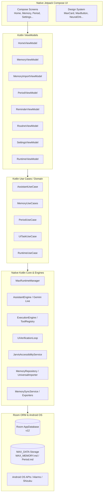

# MAX — NATIVE KOTLIN MIGRATION ARCHITECTURE AUDIT
## Phase 0 (Architecture Freeze) & Phase 1 (Complete Architecture Audit)

**Status:** ARCHITECTURE AUDIT COMPLETE — BASELINE FROZEN  
**Target:** 100% Native Kotlin • Jetpack Compose UI • Kotlin ViewModels • StateFlow/SharedFlow • Room ORM • Native Services  
**Deprecation Target:** Complete elimination of Flutter, Dart, `MethodChannel`, and `MaxNativeBridge`.

---

## 1. Executive Summary & Architecture Freeze Declaration

The MAX application possesses a deep, battle-tested, native Android subsystem comprising over **314 Kotlin source files** across automation, voice/audio streaming, local LLM orchestration, universal memory storage, hardware tool dispatch, and OS accessibility. 

### Architecture Freeze Rules (Phase 0)
1. **Zero Parallel Subsystems**: No recreation of existing Room DAOs, memory synchronization engines, tool registries, accessibility pruners, or AI connection managers.
2. **Reuse Authoritative Kotlin Systems**: All existing working components remain authoritative and will be bound directly to Kotlin ViewModels and UseCases.
3. **No Native Bridge v2**: Flutter's `MethodChannel` / `MaxNativeBridge` pattern is eliminated. Native Jetpack Compose screens interact directly with Kotlin ViewModels via type-safe reactive streams (`StateFlow` / `SharedFlow`).
4. **Isolated Data Boundaries**: Menstrual cycle data remains strictly isolated in `MAX_DATA/people/<personId>/period_data.md` and Room `period_logs`. Never merged into general memory.
5. **Runtime Master Authority**: Single runtime authority in `MaxRuntimeManager`. MAX OFF halts AI streaming, accessibility event processing, and background services with zero reconnect storms.

---

## 2. Source Tree Inventory

| Package Namespace | File Count | Core Purpose |
| :--- | :---: | :--- |
| `com.example.automation` | 164 | Heuristic and AI UI automation, 40+ native tools, verifiers, retry policies, goal planning, scheduler, action dispatch |
| `com.example.voice` | 37 | Gemini Live bidirectional streaming, audio recorder/player, audio focus, session state machine, assistant lifecycle, vision |
| `com.example.memory` | 25 | Room permanent memory, AES-GCM 256 encryption, PII masking, Universal Memory Importer, markdown sync to `MAX_MEMORY.md` |
| `com.example.data` | 16 | Room `AppDatabase`, DAOs (`ChatMessage`, `PeriodLog`, `Reminder`, `AutoReplyRule`, `InstalledApp`), period exporter, settings |
| `com.example.service` | 12 | `JarvisAccessibilityService`, `MaxCapsuleOverlayService`, `VoiceForegroundService`, `WhatsAppNotificationService`, `TelegramBotService` |
| `com.example.network` | 11 | `GeminiWebSocketClient`, `GeminiPlanningClient`, `ToolDispatcher`, Windows agent client, companion connection service |
| `com.example.core` | 11 | `MaxRuntimeManager`, `JarvisCore`, `EventBus`, `StateManager`, `ServiceRegistry`, logging infrastructure |
| `com.example.flutter` | 9 | `MaxFlutterActivity`, `MaxNativeBridge`, and 7 platform bridge delegates *(to be phased out)* |
| `com.example.ui` | 8 | Native Compose UI themes (`Color.kt`, `Theme.kt`, `Type.kt`), `JarvisNeuralOrb`, `DynamicCapsuleView`, overlay HUDs |
| `com.example.utils` | 7 | Audio helpers, system stats monitor, notification helpers, quick actions |
| `com.example.receiver` | 6 | `BootReceiver`, `ReminderReceiver`, `AppsInstalledReceiver`, `IncomingCallReceiver`, `AutoReplyActionReceiver` |
| `com.example.security` | 3 | `MaxLockAutomationEngine`, `UnlockManager`, `SecuritySettings` |
| `com.example.knowledge` | 1 | `InstalledAppsRepository` (local package manager index) |
| `com.example.telegram` | 1 | `CloudSocketManager` (remote companion tunnel) |
| `com.example.viewmodel` | 1 | `ChatViewModel.kt` (baseline voice & chat ViewModel) |
| `com.example.root` | 2 | `MainActivity.kt`, `MyApplication.kt` |
| **Total Source Files** | **314** | **100% Kotlin / Android Native Backend** |

---

## 3. Comprehensive 10-Point Component Audit Matrix



### Component 1: Room Database & DAOs (`AppDatabase`)
1. **Owner**: `com.example.data.local.AppDatabase`
2. **State owner**: SQLite / Android Room ORM
3. **Lifecycle owner**: Application Process Singleton (`AppDatabase.getDatabase(context)`)
4. **Thread/dispatcher**: Room internal query dispatcher / `Dispatchers.IO`
5. **Persistence dependency**: SQLite file `jarvis_database` (Schema version 12)
6. **UI dependency**: Zero direct UI dependencies; exposes reactive `Flow<T>` streams
7. **Background dependency**: Polled and updated by receivers, background services, sync workers
8. **Existing callers**: `MemoryRepository`, `JarvisRepository`, `PeriodMarkdownExporter`, `ChatViewModel`, `ReminderReceiver`, `SchedulerRepository`, `AutoReplyEngine`, `InstalledAppsRepository`
9. **Existing duplicate implementations**: None. Single unified Room database.
10. **Migration destination**: Retain 100% as-is. Bound to ViewModels via UseCases and Repositories.

### Component 2: MemoryRepository & Crypto Security
1. **Owner**: `com.example.memory.data.MemoryRepository`
2. **State owner**: Room `PermanentMemoryDao`, `MemorySyncStateDao` + in-memory cache
3. **Lifecycle owner**: Repository instance / Application Scope
4. **Thread/dispatcher**: `Dispatchers.IO`
5. **Persistence dependency**: Room DB + Android KeyStore (AES-GCM 256-bit via `MemoryCryptography`) + PII masking (`SensitiveDataFilter`)
6. **UI dependency**: None. Exposes `StateFlow<String>` (`memoriesMarkdownFlow`) and `Flow<List<PermanentMemory>>`
7. **Background dependency**: Automatic embeddings via `GeminiEmbeddingClient`, sync triggering to `MemorySyncService`
8. **Existing callers**: `MemoryViewModel`, `ChatViewModel`, `DataDelegate`, `UniversalMemoryImporter`, `PeriodDataSeeder`, `SaveMemoryTool`, `ForgetMemoryTool`, `SkillMemoryRepository`
9. **Existing duplicate implementations**: None. Authoritative memory engine.
10. **Migration destination**: Retain untouched. Directly injected into `MemoryViewModel` and `MemoryUseCases`.

### Component 3: MemorySyncService & MaxBackupService
1. **Owner**: `com.example.memory.sync.MemorySyncService` & `MaxBackupService`
2. **State owner**: Sync state machine and pending sync queue
3. **Lifecycle owner**: Process Singleton / Coroutine scope
4. **Thread/dispatcher**: `Dispatchers.IO`
5. **Persistence dependency**: Writes to external storage `MAX_DATA/MAX_MEMORY.md` & `MAX_DATA/backups/`
6. **UI dependency**: Zero direct UI dependency; status observable via repository
7. **Background dependency**: Triggered on Room memory mutations and system lifecycle events
8. **Existing callers**: `MemoryRepository`, `DataDelegate`, `MaxBackupService`
9. **Existing duplicate implementations**: None.
10. **Migration destination**: Headless background sync layer. Sync state displayed in Compose Memory Wallet.

### Component 4: UniversalMemoryImporter & Format Parsers
1. **Owner**: `com.example.memory.universal.UniversalMemoryImporter`
2. **State owner**: Session-scoped parsing state (`UniversalMemoryImportPreview`)
3. **Lifecycle owner**: ViewModel / Task execution scope
4. **Thread/dispatcher**: `Dispatchers.IO`
5. **Persistence dependency**: Commits parsed memories into `MemoryRepository` -> Room -> `MAX_MEMORY.md`
6. **UI dependency**: Produces structured previews for user verification before commit
7. **Background dependency**: File picker / stream reading
8. **Existing callers**: `DataDelegate.kt` (Flutter method channel)
9. **Existing duplicate implementations**: None. Supports ChatGPT, Claude, Supermemory, Rewind, Mem.ai, Markdown, JSON, and Generic text.
10. **Migration destination**: `MemoryImportViewModel` -> `UniversalMemoryImporter` -> `MemoryRepository`.

### Component 5: Period System & Isolation Exporter
1. **Owner**: `com.example.data.export.PeriodMarkdownExporter` & `PeriodLogDao`
2. **State owner**: Room `period_logs` table
3. **Lifecycle owner**: Application lifecycle
4. **Thread/dispatcher**: `Dispatchers.IO`
5. **Persistence dependency**: Isolated projection to `MAX_DATA/people/<realPersonId>/period_data.md`. NEVER placed in `MAX_MEMORY.md`.
6. **UI dependency**: Exposes data to period tracker UI
7. **Background dependency**: `MaxBackupService`, `PeriodTrackerTool`, `PeriodTrackerVerifier`
8. **Existing callers**: `DataDelegate.kt`, `PeriodTrackerTool`, `PeriodTrackerVerifier`, `MaxBackupService`
9. **Existing duplicate implementations**: None. Strict person ID validation.
10. **Migration destination**: `PeriodViewModel` -> `PeriodUseCase` -> `PeriodLogDao` & `PeriodMarkdownExporter`.

### Component 6: Reminder System & Routine Scheduler
1. **Owner**: `com.example.data.local.ReminderDao`, `com.example.receiver.ReminderReceiver`, `com.example.automation.scheduler.ScheduleTaskTool`, `com.example.automation.tools.RoutineTool`
2. **State owner**: Room DB (`ReminderDao`) + Android `AlarmManager` + `SettingsManager`
3. **Lifecycle owner**: OS `AlarmManager` + Android `BroadcastReceiver`
4. **Thread/dispatcher**: `Dispatchers.IO`
5. **Persistence dependency**: Room `reminders` table and SharedPreferences routine JSON
6. **UI dependency**: Currently queried via `DataDelegate` and `AutomationDelegate`
7. **Background dependency**: `ReminderReceiver`, `TaskReceiver`, `BootReceiver`, `WakeLock`
8. **Existing callers**: `DataDelegate`, `AutomationDelegate`, `ReminderTool`, `RoutineTool`, `JarvisRepository`
9. **Existing duplicate implementations**: None.
10. **Migration destination**: `ReminderViewModel` & `RoutineViewModel` -> Room / AlarmManager / ExecutionEngine.

### Component 7: ToolRegistry, ActionRegistry & VerificationRegistry
1. **Owner**: `com.example.automation.tools.ToolRegistry`, `com.example.automation.engine.ActionRegistry`, `com.example.automation.verification.VerificationRegistry`
2. **State owner**: In-memory registry structures (`ToolRegistry.registry`, `VerificationRegistry.registry`)
3. **Lifecycle owner**: Application lifecycle (`MyApplication.onCreate()` registers 40+ tools and freezes)
4. **Thread/dispatcher**: Registered on Main, executed on `Dispatchers.Default` / `Dispatchers.IO`
5. **Persistence dependency**: Individual tools interact with Room DAOs and Android APIs
6. **UI dependency**: Zero UI coupling; pure tool interfaces
7. **Background dependency**: Queried by `ExecutionEngine`, `AssistantEngine`, `WindowsAgentClient`, `UiAgentTool`
8. **Existing callers**: `MyApplication`, `ExecutionEngine`, `AssistantEngine`, `StreamingResponseManager`, `WindowsAgentClient`, `DiagnosticsTool`
9. **Existing duplicate implementations**: None.
10. **Migration destination**: Retain untouched. Frozen at startup.

### Component 8: ExecutionEngine, GoalPlanner & SmartRouter
1. **Owner**: `com.example.automation.engine.ExecutionEngine`
2. **State owner**: Active task coroutines, `DependencyGraph`, `LoopDetectionEngine`, `PlanOptimizer`
3. **Lifecycle owner**: Task execution scope
4. **Thread/dispatcher**: `Dispatchers.Default` / `Dispatchers.IO`
5. **Persistence dependency**: Room DB via specific action executors
6. **UI dependency**: Dispatches activity events to `AgentActivityTracker` / `AssistantEventBus`
7. **Background dependency**: `TaskReceiver`, `OfflineCommandEngine`
8. **Existing callers**: `ActionDispatcher`, `GoalPlanner`, `OfflineCommandEngine`, `RoutineTool`, `TelegramBotService`
9. **Existing duplicate implementations**: None.
10. **Migration destination**: Consumed by native ViewModels / UseCases.

### Component 9: JarvisAccessibilityService & Tree Pruner
1. **Owner**: `com.example.service.JarvisAccessibilityService`
2. **State owner**: Android OS Accessibility subsystem + `JarvisServiceStateManager`
3. **Lifecycle owner**: Android OS `AccessibilityService` lifecycle
4. **Thread/dispatcher**: Main Binder thread; background dispatchers for node pruning
5. **Persistence dependency**: None
6. **UI dependency**: Zero direct UI dependency
7. **Background dependency**: Provides click, scroll, gesture, text injection, and node hierarchy extraction
8. **Existing callers**: `UiVerificationLoop`, `ClickUiTool`, `ScrollTool`, `ScreenContextTool`, `AccessibilityStepsAction`, `AccessibilityTreePruner`
9. **Existing duplicate implementations**: None.
10. **Migration destination**: OS service remains registered; when `MaxRuntimeManager` is OFF, all incoming accessibility events are immediately bypassed.

### Component 10: UiVerificationLoop & UiAgentRouter
1. **Owner**: `com.example.automation.agent.UiVerificationLoop` & `UiAgentRouter`
2. **State owner**: Closed-loop verification state (Observe → Decide → Act → Wait → Re-observe → Verify → Recover)
3. **Lifecycle owner**: Task execution scope
4. **Thread/dispatcher**: `Dispatchers.IO` / `Dispatchers.Default`
5. **Persistence dependency**: None
6. **UI dependency**: Monitored by `AutomationDelegate.kt`
7. **Background dependency**: `JarvisAccessibilityService`, `ScreenCaptureProvider`, `AppProfileRegistry`
8. **Existing callers**: `UiAgentTool`, `AutomationDelegate.kt`
9. **Existing duplicate implementations**: None. Heuristic + Vision AI execution loop.
10. **Migration destination**: `AutomationViewModel` -> `UiTaskUseCase` -> `UiVerificationLoop`.

### Component 11: OpenRouter & Gemini LLM Planning Providers
1. **Owner**: `com.example.network.provider.GeminiPlanningProvider` & `LLMPlanningProvider`
2. **State owner**: Provider configuration instances backed by `SettingsManager`
3. **Lifecycle owner**: Application scope
4. **Thread/dispatcher**: `Dispatchers.IO` (OkHttp / Retrofit)
5. **Persistence dependency**: `SettingsManager` (Encrypted API keys and model choices)
6. **UI dependency**: None
7. **Background dependency**: Injected into `GoalPlanner` and `UiAgentRouter`
8. **Existing callers**: `MyApplication`, `GoalPlanner`, `AutomationDelegate.kt`
9. **Existing duplicate implementations**: None.
10. **Migration destination**: Injected into domain use-cases.

### Component 12: Gemini Live & AssistantEngine & Audio Stack
1. **Owner**: `com.example.voice.assistant.AssistantEngine`
2. **State owner**: `SessionStateMachine` (`SessionState`), `ConversationManager`, `AssistantEventBus`
3. **Lifecycle owner**: `AssistantLifecycleManager` (Application-wide engine lifecycle)
4. **Thread/dispatcher**: `Dispatchers.IO` (WebSocket & PCM audio streaming), `Dispatchers.Default` (DSP)
5. **Persistence dependency**: `ChatMessageDao` (chat message history)
6. **UI dependency**: Emits `AssistantEvent` for live captions, audio RMS, connection state, thinking/speaking indicators
7. **Background dependency**: `VoiceForegroundService`, `AudioRecorder`, `AudioPlayer`, `AudioFocusManager`
8. **Existing callers**: `AssistantLifecycleManager`, `ChatViewModel`, `MaxRuntimeManager`, `AssistantEngineService`, `AgentActivityTracker`
9. **Existing duplicate implementations**: None.
10. **Migration destination**: `HomeViewModel` / `AssistantViewModel` -> `AssistantUseCase` -> `AssistantEngine`.

### Component 13: MaxRuntimeManager (Master Switch)
1. **Owner**: `com.example.core.lifecycle.MaxRuntimeManager`
2. **State owner**: `_maxEnabledState: StateFlow<Boolean>` backed by `SettingsManager`
3. **Lifecycle owner**: Application Singleton (`MaxRuntimeManager.initialize(context)`)
4. **Thread/dispatcher**: `Dispatchers.Main` / `Dispatchers.IO`
5. **Persistence dependency**: `SettingsManager` (`max_runtime_enabled` preference)
6. **UI dependency**: Observed directly by UI `StateFlow`; toggled via `enableMax()` / `disableMax()`
7. **Background dependency**: Starts/stops `VoiceForegroundService`, `MaxCapsuleOverlayService`, `TelegramBotService`, controls `JarvisAccessibilityService` gating
8. **Existing callers**: `MyApplication`, `RuntimeDelegate`, `BootReceiver`, `JarvisAccessibilityService`, `ChatViewModel`, `UiVerificationLoop`
9. **Existing duplicate implementations**: None. Single master authority.
10. **Migration destination**: Direct state source for `RuntimeViewModel` and `HomeViewModel`.

### Component 14: TelegramBotService & CloudSocketManager
1. **Owner**: `com.example.service.TelegramBotService`, `com.example.telegram.CloudSocketManager`
2. **State owner**: Telegram polling loop & WebSocket connection state
3. **Lifecycle owner**: Android Foreground Service lifecycle (controlled by `MaxRuntimeManager`)
4. **Thread/dispatcher**: `Dispatchers.IO`
5. **Persistence dependency**: `SettingsManager` (`telegram_bot_token`, `telegram_chat_id`)
6. **UI dependency**: Settings UI for token entry
7. **Background dependency**: Background execution
8. **Existing callers**: `MaxRuntimeManager`, `DataDelegate`
9. **Existing duplicate implementations**: None.
10. **Migration destination**: Controlled by `MaxRuntimeManager`, configured via `SettingsViewModel`.

### Component 15: WhatsApp & Notification Services
1. **Owner**: `com.example.service.WhatsAppNotificationService`, `NotificationAppAccessManager`
2. **State owner**: OS `NotificationListenerService` state
3. **Lifecycle owner**: Android OS Notification Subsystem
4. **Thread/dispatcher**: Main binder + `Dispatchers.IO`
5. **Persistence dependency**: `AutoReplyRuleDao`, `SettingsManager`
6. **UI dependency**: Monitored apps list & auto-reply rule configuration in UI
7. **Background dependency**: Notification listener
8. **Existing callers**: `NotificationDelegate`, `AutoReplyActionReceiver`, `MediaTool`, `NotificationTool`
9. **Existing duplicate implementations**: None.
10. **Migration destination**: `NotificationViewModel` -> `NotificationUseCase` -> `NotificationAppAccessManager` / `AutoReplyRuleDao`.

### Component 16: Shizuku Integration
1. **Owner**: `com.example.automation.tools.ShizukuTool`, `com.example.automation.verification.ShizukuVerifier`
2. **State owner**: Shizuku IPC binder token
3. **Lifecycle owner**: Rikka Shizuku process lifecycle
4. **Thread/dispatcher**: `Dispatchers.IO`
5. **Persistence dependency**: None
6. **UI dependency**: Permission status displayed in Permissions screen
7. **Background dependency**: Shizuku daemon
8. **Existing callers**: `MyApplication`, `ToolRegistry`, `VerificationRegistry`
9. **Existing duplicate implementations**: None.
10. **Migration destination**: `PermissionViewModel` queries status; tool executes via Shizuku binder.

### Component 17: Lock Automation & Security
1. **Owner**: `com.example.memory.security.MemoryCryptography`, `SensitiveDataFilter`, `UnlockManager`, `MaxLockAutomationEngine`
2. **State owner**: Device lock state & encrypted credentials
3. **Lifecycle owner**: Process scope
4. **Thread/dispatcher**: `Dispatchers.Default` / `Dispatchers.IO`
5. **Persistence dependency**: `EncryptedSharedPreferences` / Android KeyStore
6. **UI dependency**: Biometric prompt and security settings UI
7. **Background dependency**: Automated screen wake & unlock for scheduled routines
8. **Existing callers**: `MemoryRepository`, `UniversalMemoryImporter`, `ReminderReceiver`, `UnlockTool`
9. **Existing duplicate implementations**: None.
10. **Migration destination**: Retain as security domain components.

### Component 18: InstalledAppsRepository
1. **Owner**: `com.example.knowledge.apps.InstalledAppsRepository`
2. **State owner**: Room `InstalledAppDao` cache table
3. **Lifecycle owner**: Application scope
4. **Thread/dispatcher**: `Dispatchers.IO`
5. **Persistence dependency**: Room table `installed_apps`
6. **UI dependency**: None
7. **Background dependency**: Triggered on `AppsInstalledReceiver` and app boot
8. **Existing callers**: `MyApplication`, `AppsInstalledReceiver`, `OpenAppAction`, `GoalPlanner`, `OpenAppVerifier`
9. **Existing duplicate implementations**: None.
10. **Migration destination**: Queried by automation use cases and search tools.

### Component 19: Flutter Bridge Layer (`MaxNativeBridge` + 7 Delegates)
1. **Owner**: `com.example.flutter.MaxNativeBridge`, `MaxFlutterActivity`, 7 delegate classes
2. **State owner**: Flutter `MethodChannel("com.example.jarvis/native")`
3. **Lifecycle owner**: `MaxFlutterActivity`
4. **Thread/dispatcher**: Android Main Thread
5. **Persistence dependency**: None (delegates to Room and `SettingsManager`)
6. **UI dependency**: High (monolithic bridge to Flutter Dart UI)
7. **Background dependency**: Forwards Flutter calls to Kotlin singletons
8. **Existing callers**: `MaxFlutterActivity`, `max_flutter/lib/services/*.dart`
9. **Existing duplicate implementations**: Flutter-to-Kotlin translation layer
10. **Migration destination**: **TO BE DELETED ENTIRELY** after Native Jetpack Compose screens are fully migrated and tested.

### Component 20: ViewModels & Compose UI Shell
1. **Existing Baseline**: `ChatViewModel.kt`, `MemoryViewModel.kt`, legacy `MainActivity.kt`
2. **Migration destination**:
   - Single Activity: `MainActivity.kt` (`ComponentActivity` hosting `MaxApp()` and `MaxNavGraph()`)
   - Centralized ViewModels: `HomeViewModel`, `MemoryViewModel`, `MemoryImportViewModel`, `PeriodViewModel`, `ReminderViewModel`, `RoutineViewModel`, `NotificationViewModel`, `PermissionViewModel`, `CapabilityViewModel`, `SettingsViewModel`, `RuntimeViewModel`
   - Native Design System: `ui/theme/` (`Color.kt`, `Typography.kt`, `Shape.kt`, `Theme.kt`, `Dimensions.kt`) + Reusable components (`MaxCard`, `MaxButton`, `MaxTextField`, `MaxTopBar`, `MaxStatusBadge`, `MaxVoiceVisualizer`, `MaxQuickAction`, `MaxEmptyState`, `MaxLoadingState`, `MaxErrorState`).

---

## 4. Migration Roadmap (Screen by Screen)

```
Step 1: Architecture Audit & Freeze (Phase 0 & 1) -> COMPLETE
Step 2: Compose Design System + Application Shell (MainActivity, MaxApp, MaxNavGraph, MaxTheme)
Step 3: State Contracts & UseCases
Step 4: Screen 1 — Home + Chat (HomeViewModel + Neural Orb + Live Streaming + Quick Actions)
Step 5: Test Screen 1 (Unit tests, Build verification, Physical device validation)
Step 6: Screen 2 — Settings
Step 7: Screen 3 — Permissions
Step 8: Screen 4 — Memory Wallet
Step 9: Screen 5 — Universal Memory Import
Step 10: Screen 6 — Period Tracker
Step 11: Screen 7 — Reminders
Step 12: Screen 8 — Routines
Step 13: Screen 9 — Notifications
Step 14: Screen 10 — Capabilities
Step 15: Screen 11 — About & Privacy
Step 16: Screen 12 — Onboarding
Step 17: Full System Verification & Flutter Removal
```

---

## 5. Audit Sign-off

- **Audit Date**: 2026-08-28
- **Total Components Audited**: 20 major systems (314 Kotlin source files)
- **Architecture Freeze**: ACTIVE
- **Ready for Next Phase**: YES
