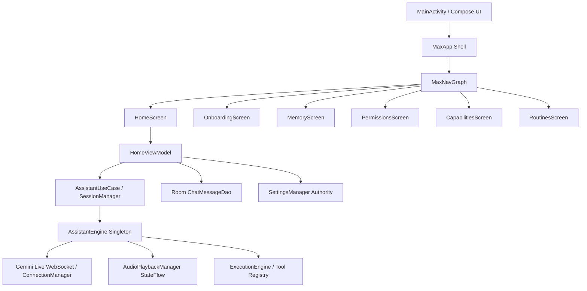

# MAX — NATIVE ANDROID UI ARCHITECTURE & STATE CONTRACTS

## 1. Architectural Overview
MAX is an offline-first, real-time multimodal AI assistant built 100% on native Android Kotlin and Jetpack Compose (Compose BOM 2024.09.00 / Kotlin 2.3.20 / Android SDK 36).

---

## 2. State Isolation & Recomposition Optimization

To guarantee consistent 60–120 FPS performance during live voice sessions:

1. **Monolithic UI State (`HomeUiState`)**:
   Contains low-frequency UI model state (messages, connection status, error dialogs, pending automations).
2. **High-Frequency Fast Flows**:
   - `audioRms: StateFlow<Float>` (50Hz audio amplitude)
   - `liveUserCaption: StateFlow<String>` (streaming STT)
   - `liveAiCaption: StateFlow<String>` (streaming LLM response)
   - Observed locally in `VoiceLiveBanner` and `EmptyChatState` without invalidating the parent `LazyColumn` or `Scaffold`.

---

## 3. Audio Playback Observation Pattern
`AudioPlaybackManager` exposes `val isPlayingFlow: StateFlow<Boolean>`.
- Multiple concurrent consumers (`HomeViewModel`, `ChatViewModel`, `VoiceSession`) collect state safely without callback overwrite races.
- Automatic reset of `isThinking = false` occurs whenever `isPlayingFlow` emits `true` or connection drops.

---

## 4. Permission Architecture
- **In-App Runtime Permissions**: Mic, Camera, Notifications, Contacts, Phone, SMS, Location are requested natively in-app via `rememberLauncherForActivityResult(ActivityResultContracts.RequestMultiplePermissions())`.
- **System Privileges**: Accessibility, Overlay (`SYSTEM_ALERT_WINDOW`), Battery Optimization ignore, and Shizuku are dispatched directly to their respective Android system settings intents.

---

## 5. Media & File Persistence
- **Camera Photos**: Dispatches `MediaStore.ACTION_IMAGE_CAPTURE` with `EXTRA_OUTPUT` pointing to `Pictures/MAX` via `MediaStore.Images.Media.EXTERNAL_CONTENT_URI`.
- **Screenshots**: Screen captures are compressed to JPEG and written to `Pictures/Screenshots` via `ContentResolver.openOutputStream()`.
