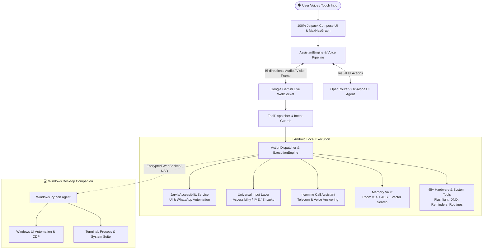

# MAX AI Assistant ⚡🤖

[](https://kotlinlang.org/)
[](https://developer.android.com/jetpack/compose)
[-3DDC84?style=for-the-badge&logo=android&logoColor=white)](https://developer.android.com/)
[](https://www.python.org/)
[](https://ai.google.dev/)
[](LICENSE)

**MAX** is a state-of-the-art, cross-device autonomous AI agent and voice assistant. It seamlessly orchestrates your **Android smartphone** and **Windows desktop**, executing complex device automations, multi-step agentic workflows, real-time multimodal voice/vision conversations, and hands-free communications.

---

## 🌟 Key Highlights & Architecture



---

## 📱 Subsystems & Capabilities

### 1. 🎙️ Gemini Live Real-Time Voice & Vision Engine
- **Ultra-Low Latency WebSocket Pipeline**: Direct bi-directional PCM audio streaming to `gemini-3.1-flash-live-preview` with real-time barge-in and conversational interruption.
- **Multimodal Screen Reasoning**: Captures high-frequency RAM screenshots (via Shizuku exec-out / Accessibility) and injects JPEG video frames into Gemini Live for real-time visual reasoning.
- **Dynamic Waveform Visualization**: Hardware-accelerated audio visualizer with reactive state badges (`OFFLINE`, `CONNECTING`, `ONLINE`, `LISTENING`, `THINKING`, `SPEAKING`).

### 2. 🤖 Autonomous UI Automation & Intent Routing
- **Dual-Model UI Agent Engine**: Dynamic UI automation powered by OpenRouter (`stealth/ox-alpha` primary) with Gemini fallback, featuring closed-loop `UiVerificationLoop` and element grounding.
- **Bulletproof Intent Routing Guards**: Anchored regex and authorization gates that protect against LLM intent collisions (e.g. dictating *"call back later"* in a WhatsApp message will never trigger a legacy `CALL_PHONE` action).
- **Universal Input & Keyboard Controller (Phase 8)**: 3-tier typing fallback (Accessibility `ACTION_SET_TEXT` / `ACTION_IME_ENTER` $\rightarrow$ Grounded Semantic Controls $\rightarrow$ Shizuku / ADB Shell).

### 3. 💬 WhatsApp & Social Automation
- **Autonomous Messaging**: Deep-link and Accessibility-based contact resolution with top toolbar header verification and preview snippet collision rejection.
- **Incoming Call Assistant**: Layered caller resolution (`PhoneLookup`, call logs, accessibility UI scraping), voice announcement, hands-free voice answering/rejection, and follow-up SMS/WhatsApp auto-replies.
- **Notification Bridge**: Listens and parses notifications with AI-powered smart replies.

### 4. 🧠 Encrypted Memory Vault (Vector + Keyword Search)
- **Room Database v14**: Fully offline, AES-256 encrypted memory vault with category filtering, pinning, and tag search.
- **Hybrid Semantic Search**: 768-dimensional embeddings (`text-embedding-004`) combined with cosine similarity + BM25 keyword matching for contextual memory recall.

### 5. 💻 Windows Desktop Agent (`/windows-agent`)
- **System & App Automation**: UIA control, terminal execution, file system management, process supervision, and power controls.
- **Browser Automation & CDP**: Chrome DevTools Protocol integration for automated web scraping and web tasks.
- **Developer & Productivity Suite**: Code sandbox, git integration, document processing, kanban manager, and real-time dashboard.

---

## 🗂️ Project Structure

```
gemini-live/
├── app/                              # Android Native Subsystem (Kotlin & Jetpack Compose)
│   ├── src/main/java/com/example/
│   │   ├── automation/               # ExecutionEngine, ActionDispatcher, UI Agents
│   │   │   ├── agent/                # OpenRouter / Gemini UI Agent providers
│   │   │   ├── engine/               # TaskPlanner, ActionAuthorizer, InputController
│   │   │   └── accessibility/        # JarvisAccessibilityService & WhatsApp resolvers
│   │   ├── network/                  # GeminiWebSocketClient & ToolDispatcher (45+ tools)
│   │   ├── voice/                    # AssistantEngine, AudioRecorder, PlaybackManager
│   │   ├── telephony/                # IncomingCallFlowState, CallManager & Receiver
│   │   ├── memory/                   # PermanentMemoryDao, Vector Search & Embeddings
│   │   └── ui/                       # 100% Jetpack Compose UI (MaxApp, HomeScreen, Onboarding, Memory, Settings)
│   └── src/test/java/com/example/    # Comprehensive unit tests & routing guards
├── windows-agent/                    # Windows Desktop Agent (Python)
│   ├── core/                         # Event loop, Protocol envelopes, Device routers
│   ├── tools/                        # UIA, Terminal, App control, Browser CDP, Code sandbox
│   └── tests/                        # Comprehensive desktop test suites
├── docs/max/                         # Detailed subsystem architecture docs
├── MAX_ARCHITECTURE.md               # Technical architecture & pipeline diagrams
├── MAX_PROJECT_MAP.md                # Component & navigation index
└── MAX_PROJECT_STATE.md              # Living project status & feature matrix
```

---

## 🚀 Getting Started

### Prerequisites
- **Android**: Android Studio Ladybug / Meerkat (Gradle 8.x, JDK 17+, Android SDK 36)
- **Target Hardware**: Android device with API 31+ (Root + Shizuku recommended for full autonomous power)
- **Desktop**: Python 3.11+ (Windows 10/11)
- **API Keys**: Google Gemini API Key and/or OpenRouter API Key

---

### 📱 Android Application Setup

1. **Clone the Repository**:
   ```bash
   git clone https://github.com/yash2122s/Max-ai-assistant.git
   cd Max-ai-assistant
   ```

2. **Configure API Keys**:
   Create a `.env` file in the root directory:
   ```env
   GEMINI_API_KEY=your_gemini_api_key_here
   OPENROUTER_API_KEY=your_openrouter_api_key_here
   ```

3. **Build & Install**:
   ```bash
   ./gradlew installDebug
   ```

4. **Grant Permissions**:
   Open MAX on your device and navigate to the **Permissions Manager** (`/permissions` in drawer) to activate the 11 system capabilities (Microphone, Accessibility, Notifications, Overlay, etc.).

---

### 💻 Windows Agent Setup

1. **Navigate to the agent directory**:
   ```bash
   cd windows-agent
   ```

2. **Install Dependencies**:
   ```bash
   python -m venv venv
   .\venv\Scripts\activate
   pip install -r requirements.txt
   ```

3. **Start the Agent**:
   ```bash
   python run.py
   # Or run startup script:
   .\startup.bat
   ```

4. **Pair with Android**:
   The Android app discovers the desktop agent automatically via Network Service Discovery (NSD) over local Wi-Fi.

---

## 🧪 Testing & Verification

Run the comprehensive unit test suite to verify routing integrity and dispatch boundaries:

```bash
# Android Unit Tests
./gradlew testDebugUnitTest --tests "com.example.automation.IntentRoutingGuardUnitTest"

# Windows Agent Tests
cd windows-agent
pytest tests/
```

---

## 🔒 Security & Privacy Invariants

- **Encrypted Local Storage**: Zero plaintext secrets or sensitive memories stored on disk.
- **Explicit Dispatch Boundaries**: Critical physical actions (e.g. initiating outbound phone calls) require verified intent matching and strict authorization gates.
- **Local Network Isolation**: Communication between Android and PC operates strictly over encrypted local WebSockets without intermediary cloud servers.

---

## 📄 License
This project is licensed under the Apache License 2.0 - see the [LICENSE](LICENSE) file for details.
