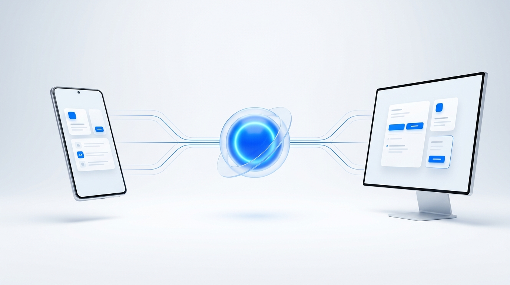
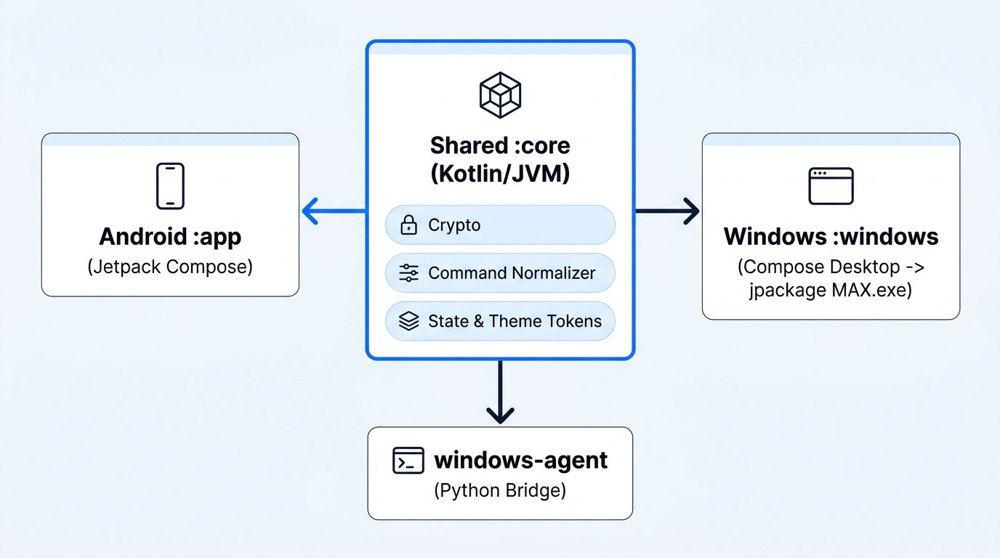
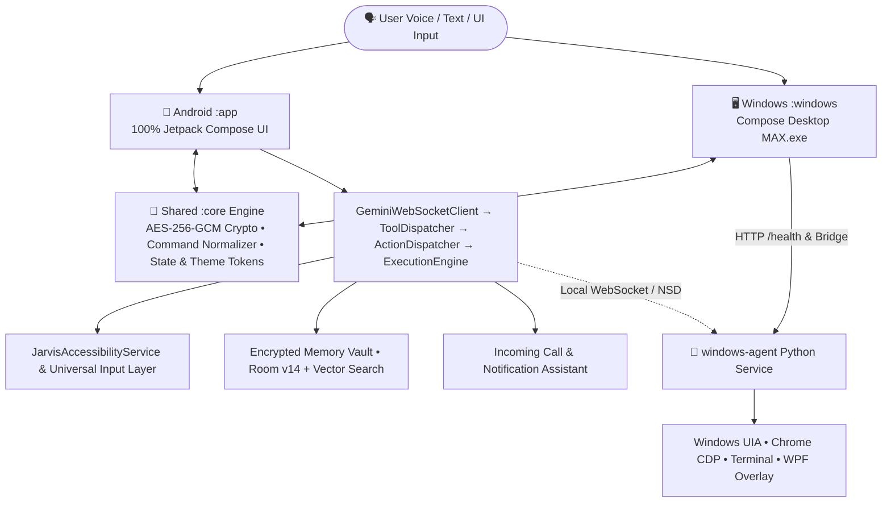
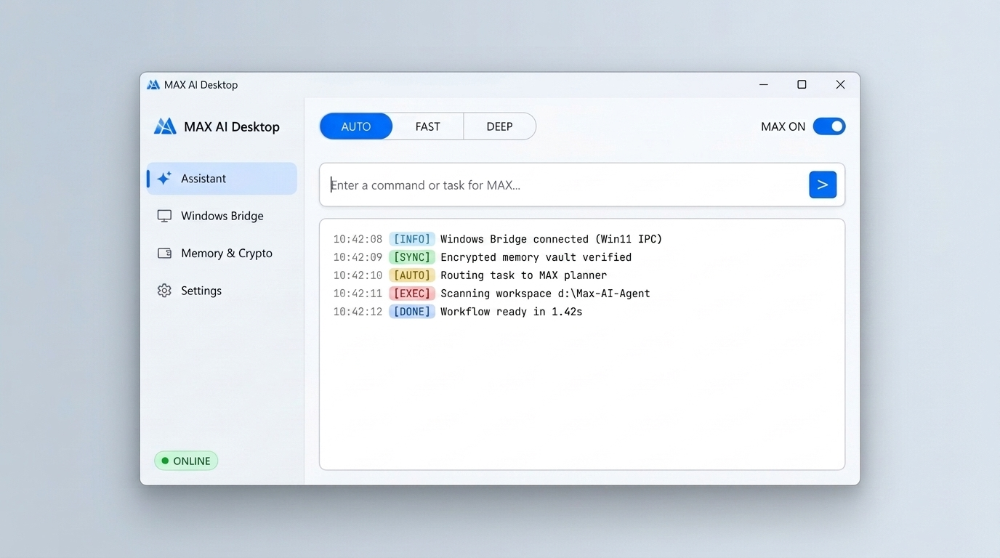

<p align="center">
  
</p>

<h1 align="center">MAX AI Assistant ⚡🤖</h1>

<p align="center">
  <strong>Cross-Device Autonomous AI Agent for Android (Jetpack Compose) &amp; Windows Desktop (Compose Desktop + Self-Contained Native Runtime)</strong>
</p>

<p align="center">
  <a href="https://kotlinlang.org/"></a>
  <a href="https://developer.android.com/jetpack/compose"></a>
  <a href="https://www.jetbrains.com/compose-multiplatform/"></a>
  <a href="https://developer.android.com/"></a>
  <a href="https://www.python.org/"></a>
  <a href="https://ai.google.dev/"></a>
</p>

---

## 🌟 Overview

**MAX** is a cross-device autonomous AI agent and real-time voice/desktop assistant that unifies your **Android smartphone** and **Windows 11 PC**. It combines a native Jetpack Compose Android app (`:app`), a shared Kotlin/JVM core engine (`:core`), a native Compose Desktop Windows application (`:windows` packaged into a standalone `MAX.exe` via `jpackage`), and a Python desktop automation companion (`windows-agent/`).

---

## 🏗️ Cross-Device Architecture

<p align="center">
  
</p>



---

## 🖥️ MAX Desktop Variant (`:windows` + `:core`)

<p align="center">
  
</p>

The Windows desktop variant shares business logic, cryptographic primitives, command normalization, and Material 3 design tokens directly with the Android app through the `:core` Gradle module, and compiles into a self-contained portable Windows x64 executable (`MAX.exe`) with **zero Java installation required** on the target machine.

### Every Desktop Option Explained

| Control / Section | What It Does |
| :--- | :--- |
| **Mode Selector (`AUTO` / `FAST` / `DEEP`)** | Switches the active model routing profile: **`FAST`** (`gemini-3.8-live`) for low-latency direct actions, **`DEEP`** (`gemini-3.8-live-extended-thinking`) for complex multi-step reasoning, and **`AUTO`** for adaptive routing. |
| **Global `MAX` Switch (ON / OFF)** | Master runtime toggle mirroring Android's `MaxRuntimeManager`. When **OFF**, blocks command execution (except `/status` and `/toggle`) and sets state to `OFF`. |
| **Theme Toggle (☀️ / 🌙)** | Switches instantly between MAX's **White Light Theme** (`#F8FAFC` / `#FFFFFF` / `#0066FF`) and **Dark Theme** (`#0B1120` / `#111827`) using shared `MaxThemeTokens`. |
| **Live State Pill (`State: ONLINE`)** | Displays the authoritative runtime state (`OFF`, `OFFLINE`, `CONNECTING`, `ONLINE`, `LISTENING`, `THINKING`, `SPEAKING`, `ERROR`). |
| **`Assistant` Tab** | Interactive command console with quick-action chips (`/status`, `/ping bridge`, `Home Intent`, `SHA-256 Sample`), English + Telugu/Tinglish command normalization via `MaxCommandNormalizer`, and a timestamped monospace activity log. |
| **`Windows Bridge` Tab** | Configures and health-checks the local `windows-agent` Python automation service (default `http://127.0.0.1:8000/health`). |
| **`Memory & Crypto` Tab** | Interactive demonstration of the shared `:core` `MaxCrypto` engine: `PBKDF2WithHmacSHA256` key derivation, `AES-256-GCM` authenticated encryption/decryption, and `SHA-256` deduplication hashes. |
| **`Settings` Tab** | Displays the active model ID, shared `:core` JVM target info, and `jpackage` runtime packaging configuration. |

---

## 📱 Android Subsystems & Capabilities (`:app`)

1. **🎙️ Gemini Live Real-Time Voice & Vision Engine**
   - Bi-directional PCM audio streaming over WebSocket (`GeminiWebSocketClient`) with barge-in interruption and dynamic waveform visualization.
   - Dual-model routing (**FAST** vs **DEEP** extended thinking) with seamless `ModelHandoffContext` state transfer.
   - High-frequency screen capture injection for multimodal visual reasoning.

2. **⚙️ Strict Execution Pipeline**
   - Preserves the deterministic dispatch boundary:
     `GeminiWebSocketClient → ToolDispatcher → ActionDispatcher → ExecutionEngine`
   - **45+ Registered Tools** in `MyApplication.kt`, plus `IntentRoutingGuard` protections against accidental phone/messaging triggers.

3. **🤖 Autonomous UI Automation & Universal Input (Phase 8)**
   - **Dual-Provider UI Agent**: `OpenRouterUiAgentProvider` (`stealth/ox-alpha` primary) + `GeminiUiAgentProvider` fallback with closed-loop `UiVerificationLoop`.
   - **3-Tier Keyboard & Input Layer**: Accessibility `ACTION_SET_TEXT` / `ACTION_IME_ENTER` → Grounded Semantic Controls → Shizuku / ADB Shell fallback.
   - **WhatsApp & Social Automation**: Contact resolution with top-toolbar header verification, preview snippet rejection, and 6-step verified send state machine.

4. **🧠 Encrypted Memory Vault & Smart Home**
   - **Room Database v14** (`jarvis_database`) with AES encryption, category filtering, pinning, and hybrid semantic/keyword search.
   - **Smart Home**: Local network LG TV remote & Wake-on-LAN control (`com.example.smarthome.TvRemote`).

5. **🛡️ Permissions Manager & Runtime Controls**
   - Centralized management for 11 Android capabilities (Microphone, Accessibility, Notifications, Contacts, Phone, SMS, Location, Camera, Overlay, Battery Optimization, Notification Listener).
   - Global `MaxRuntimeManager` ON/OFF master switch that safely suspends/restores services while preserving alarms and reminders.

---

## 🐍 Windows Python Companion (`windows-agent/`)

- **Entrypoint**: `windows-agent/main.py` (launched via `startup.bat`).
- **Automation Tools**: Windows UI Automation (UIA), Chrome DevTools Protocol (CDP), terminal/process supervision, filesystem tools, and a plain-JS local dashboard (`windows-agent/dashboard/`).
- **Native Overlay**: `windows-agent/MAXOverlay/` (WPF `.NET 8` desktop overlay).

---

## 📦 Building & Packaging the Portable Windows App

### 1. Shared Logic + Compose Desktop Compilation
Stages `windows.jar` and all runtime JAR dependencies under `windows/build/install/windows/lib`:
```powershell
.\gradlew.bat :core:test :windows:installDist --console=plain
```

### 2. Self-Contained Native Runtime (`jpackage.exe` + `tar.exe`)
Run the automated build script (requires Eclipse Adoptium JDK 21+):
```powershell
powershell -ExecutionPolicy Bypass -File scripts\build-windows-desktop.ps1
```
This runs:
1. `.\gradlew.bat :core:test :windows:installDist --console=plain`
2. `jpackage --type app-image --name MAX --input windows/build/install/windows/lib --main-jar windows.jar --main-class com.maxaiagent.windows.MainKt --dest build/jpackage --add-modules java.desktop,java.logging,java.management,java.naming,java.net.http,jdk.crypto.ec,jdk.unsupported,jdk.accessibility,java.security.jgss`
3. `tar.exe -a -cf dist/MAX-Windows-x64.zip -C build/jpackage MAX`

Anyone on **Windows 11 x64** can extract `dist/MAX-Windows-x64.zip` and double-click `MAX\MAX.exe` without installing Java.

### 3. Automated GitHub Releases
Pushing any `v*` tag triggers [`.github/workflows/release.yml`](.github/workflows/release.yml) on `windows-latest` to build, zip, and attach `MAX-Windows-x64.zip` to the GitHub Release.

---

## 🛠️ Android & Python Development Setup

### Android (`:app`)
```powershell
$env:JAVA_HOME='C:\Program Files\Eclipse Adoptium\jdk-25.0.2.10-hotspot'
.\gradlew.bat :app:assembleDebug --console=plain
.\gradlew.bat :app:testDebugUnitTest --tests com.example.automation.IntentRoutingGuardUnitTest --console=plain
```

### Windows Python Agent (`windows-agent/`)
```powershell
cd windows-agent
.\.venv\Scripts\python.exe -m pytest tests/test_network_and_recovery.py --tb=short -q
```

---

## 🗂️ Repository Structure

```text
Max-AI-Agent/
├── core/                               # Shared Kotlin/JVM engine (crypto, models, theme tokens, normalizer)
├── windows/                            # Compose Desktop Windows app (packages into MAX.exe)
├── app/                                # Android Jetpack Compose app (com.maxaiagent.yash)
├── windows-agent/                      # Python desktop automation service + dashboard + MAXOverlay
├── scripts/build-windows-desktop.ps1   # One-command jpackage + tar.exe portable ZIP builder
├── .github/workflows/release.yml       # Automated windows-latest release pipeline
└── docs/                               # Subsystem documentation & README visual assets
```

---

## 🔒 Security & Privacy

- **Zero Hardcoded Secrets**: API keys and signing credentials live only in local `.env` / `keystore.properties` (gitignored).
- **Authenticated Encryption**: `:core` uses `PBKDF2WithHmacSHA256` (100,000 iterations) + `AES/GCM/NoPadding` (128-bit auth tag).
- **Strict Dispatch & Origin Guards**: Outbound actions and native overlay WebSockets enforce explicit authorization and origin checks.
