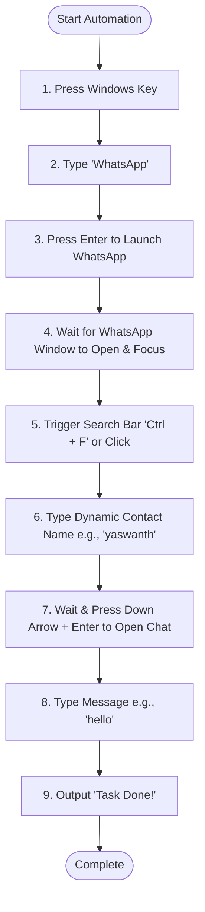

# 📱 WhatsApp Desktop Automation Workflow

ఈ డాక్యుమెంట్‌లో Windows PC లో WhatsApp ని ఆటోమేట్ చేసి, కాంటాక్ట్‌ను సెర్చ్ చేసి, మెసేజ్ టైప్ చేసే పూర్తి వర్క్‌ఫ్లో (Workflow) వివరంగా ఉంది.

---

## 📋 Table of Contents
1. [Workflow Overview](#1--workflow-overview)
2. [Step-by-Step Execution Table](#2-️-step-by-step-execution-table)
3. [Keyboard Shortcuts & UI Strategies](#3-️-keyboard-shortcuts--ui-strategies)
4. [Dynamic Search & Parameterization](#4--dynamic-search--parameterization-డైనమిక్-గా-ఎలా-మార్చాలి)
5. [JSON Workflow Architecture](#5--json-workflow-architecture)
6. [Available Scripts & How to Run](#6--available-scripts--how-to-run)

---

## 1. 🔄 Workflow Overview



---

## 2. 📝 Step-by-Step Execution Table

| Step # | Action Name | Telugu Description | English Description | Key / Automation Trigger | Default / Example Value |
| :---: | :--- | :--- | :--- | :--- | :--- |
| **1** | **Press Win Key** | Windows Start మెనూ ఓపెన్ చేయడానికి Windows కీ ప్రెస్ చేయడం. | Press Windows key to open Start Menu. | `pyautogui.press('win')` | `{VK_LWIN}` |
| **2** | **Search WhatsApp** | స్టార్ట్ మెనూలో "WhatsApp" అని టైప్ చేయడం. | Search "WhatsApp" application. | `pyautogui.write('WhatsApp', 0.08)` | `WhatsApp` |
| **3** | **Launch App** | WhatsApp ను ఓపెన్ చేయడానికి Enter కీ ప్రెస్ చేయడం. | Press Enter to launch WhatsApp. | `pyautogui.press('enter')` | `{ENTER}` |
| **4** | **Wait & Focus** | యాప్ లోడ్ అయ్యే వరకు వేచి చూడటం (2.5 సెకన్లు). | Wait for WhatsApp window to stabilize. | `time.sleep(2.5)` | 2.5 seconds |
| **5** | **Focus Search Bar** | WhatsApp సెర్చ్ బార్‌ను యాక్టివేట్ చేయడానికి `Ctrl + F` ప్రెస్ చేయడం. | Focus search box using shortcut `Ctrl+F`. | `pyautogui.hotkey('ctrl', 'f')` | `^f` |
| **6** | **Search Contact** | కాంటాక్ట్ పేరును (డైనమిక్: `yaswanth`) టైప్ చేయడం. | Type dynamic contact name. | `pyautogui.write(contact, 0.08)` | Dynamic: `yaswanth` |
| **7** | **Open Chat** | రిజల్ట్స్ నుండి మొదటి చాట్ సెలెక్ట్ చేసి ఓపెన్ చేయడం. | Navigate to top result & press Enter. | `Down Arrow` -> `Enter` | `{DOWN}` `{ENTER}` |
| **8** | **Type Message** | చాట్ మెసేజ్ బాక్స్‌లో `hello` అని టైప్ చేయడం. | Type message in active chat box. | `pyautogui.write(msg, 0.05)` | Dynamic: `hello` |
| **9** | **Completion Status** | టాస్క్ పూర్తయినట్లు 'Task Done!' అని తెలియజేయడం. | Report completion status. | `print("🎉 Task Done!")` | `Task Done!` |

---

## 3. ⌨️ Keyboard Shortcuts & UI Strategies

### Strategy A: Keyboard Accelerator Navigation (Fastest & Most Reliable)
1. **`Win`** -> టైప్ **`WhatsApp`** -> **`Enter`** (App opens directly).
2. WhatsApp విండో ఓపెన్ అయ్యాక **`Ctrl + F`** (లేదా **`Ctrl + E`**) ప్రెస్ చేస్తే నేరుగా Contact Search Box ఫోకస్ అవుతుంది.
3. Contact Name టైప్ చేసిన తర్వాత **`Down Arrow`** కొట్టి **`Enter`** ప్రెస్ చేస్తే ఆ వ్యక్తి చాట్ స్క్రీన్ ఓపెన్ అవుతుంది.
4. కర్సర్ నేరుగా Type Message బాక్స్‌లో ఉంటుంది. అక్కడ Message టైప్ అవుతుంది.

### Strategy B: Native Windows Protocol URI (Instant Zero-Search Link)
Windows లో డైరెక్ట్ గా కాంటాక్ట్ లేదా మెసేజ్ ఓపెన్ చేయడానికి URL ప్రోటోకాల్:
```cmd
start whatsapp://send?text=hello
```

---

## 4. 🔀 Dynamic Search & Parameterization (డైనమిక్ గా ఎలా మార్చాలి?)

సెర్చ్ చేసే పేరును (Contact Name) మరియు టైప్ చేసే మెసేజ్ ను (Message Text) హార్డ్‌కోడ్ చేయకుండా సులభంగా మార్చడానికి 4 మార్గాలు:

### మార్గం 1: Command Line Arguments (CLI Flags)
కమాండ్ ప్రాంప్ట్ / టెర్మినల్ ద్వారా మీకు నచ్చిన పేరు మరియు మెసేజ్ ఇవ్వవచ్చు:
```bash
# ఉదాహరణ 1: yaswanth కి hello
py whatsapp_automation.py --contact "yaswanth" --message "hello"

# ఉదాహరణ 2: Rahul కి వేరే మెసేజ్
py whatsapp_automation.py --contact "Rahul" --message "Meeting at 5 PM"

# ఉదాహరణ 3: టైప్ చేసిన వెంటనే Send చేయాలనుకుంటే (--send ఫ్లాగ్)
py whatsapp_automation.py --contact "yaswanth" --message "hello" --send
```

### మార్గం 2: `config.json` ద్వారా
`config.json` ఫైల్‌లో మార్పులు చేస్తే స్క్రిప్ట్ ఆటోమేటిక్ గా ఆ వివరాలు తీసుకుంటుంది:
```json
{
  "target_contact": "yaswanth",
  "message_text": "hello",
  "send_message": false,
  "launch_wait_seconds": 2.5
}
```

### మార్గం 3: Dynamic JSON Workflow Runner
`workflow.json` లోని టెంప్లేట్ వేరియబుల్స్ (`{{TARGET_CONTACT}}`, `{{MESSAGE_TEXT}}`) ను రీప్లేస్ చేస్తూ రన్ చేయడానికి:
```bash
py dynamic_workflow_runner.py --contact "yaswanth" --message "hello"
```

### మార్గం 4: Interactive Mode (అడిగి తీసుకునే పద్ధతి)
ఆర్గ్యుమెంట్స్ ఏమీ ఇవ్వకపోతే స్క్రిప్ట్ యూజర్‌ని ఇంటరాక్టివ్‌గా అడుగుతుంది:
```bash
py whatsapp_automation.py --interactive
```

---

## 5. 🏗️ JSON Workflow Architecture
`workflow.json` ఫైల్ ఒక స్టాండర్డ్ మెషిన్-రీడబుల్ ఫార్మాట్‌లో ఉంటుంది. ఇందులో ప్రతి స్టెప్ యొక్క:
- `step_number`, `id`, `title`
- `action_type`: (`key_press`, `type_text`, `hotkey`, `key_sequence`, `notify`)
- `params`: కీలు, డైనమిక్ టెక్స్ట్, డిలే టైమింగ్స్
ఉంటాయి. భవిష్యత్తులో ఏదైనా AI Agent / MAX Automation Engine ఈ JSON ను నేరుగా ఎగ్జిక్యూట్ చేయగలదు.

---

## 6. 🚀 Available Scripts & How to Run

ఈ ఫోల్డర్‌లో క్రింది ఫైల్స్ సిద్ధంగా ఉన్నాయి:
1. `workflow.md` — పూర్తి వర్క్‌ఫ్లో డాక్యుమెంటేషన్.
2. `workflow.json` — స్ట్రక్చర్డ్ JSON వర్క్‌ఫ్లో డెఫినిషన్.
3. `whatsapp_automation.py` — పూర్తి ఫీచర్లతో కూడిన డైనమిక్ పైథాన్ ఆటోమేషన్ స్క్రిప్ట్.
4. `dynamic_workflow_runner.py` — `workflow.json` ను రీడ్ చేసి స్టెప్-బై-స్టెప్ రన్ చేసే ఇంజిన్.
5. `config.json` — డైనమిక్ కాన్ఫిగరేషన్ సెట్టింగ్స్.
6. `whatsapp_powershell.ps1` — ప్యూర్ Windows PowerShell ద్వారా పైథాన్ లేకుండా రన్ అయ్యే స్క్రిప్ట్.

### రన్ చేసే విధానం:
```powershell
# పైథాన్ స్క్రిప్ట్ రన్ చేయడం:
py whatsapp_automation.py --contact "yaswanth" --message "hello"

# లేదా JSON వర్క్‌ఫ్లో రన్నర్ ద్వారా:
py dynamic_workflow_runner.py --contact "yaswanth" --message "hello"
```